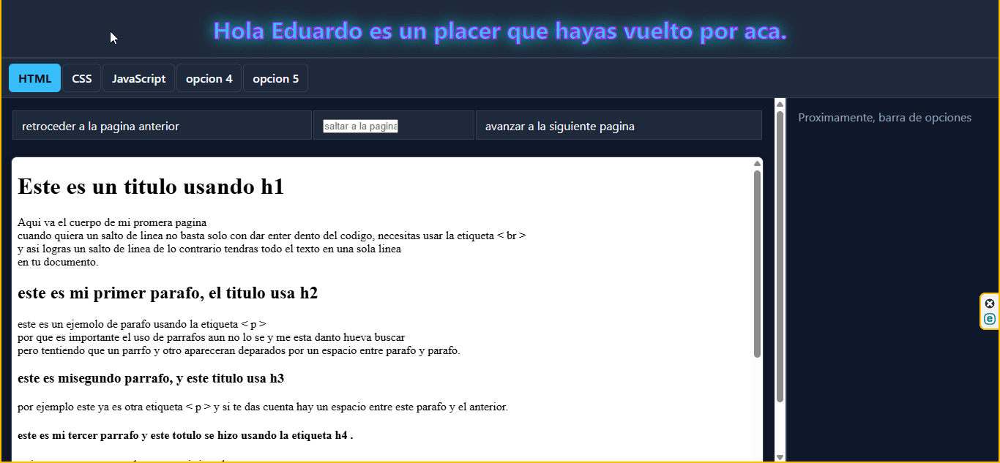

# Visor de Lecciones Frontend


Bienvenido a mi bitácora interactiva de aprendizaje web. Este proyecto fue desarrollado desde cero con el objetivo de registrar, practicar y consolidar de manera práctica mi progreso diario en tecnologías **Frontend** (HTML, CSS, JavaScript).

---

## Vista Previa de la Interfaz

> Interfaz dinámica con soporte para navegación interactiva de lecciones, diseño en modo oscuro (*Dark Mode*) y efectos visuales en CSS.



---

## Tecnologías y Conceptos Aplicados

### **Frontend & Maquetación**
* **HTML:** Estructuración mediante `header`, `main`, `aside` y contenedores `iframe` para renderizar archivos independientes.

* **CSS:** 
  * Layout responsivo utilizando **Flexbox**.
  * Paleta de colores personalizada *Dark Mode / Neón* para mejor legibilidad.
  * Transiciones fluídas (`transition`) y animaciones fotograma a fotograma (`@keyframes`).
  * Estilos de interacción con pseudoclases (`:hover`, `:active`).
* **JavaScript:**
  * Manipulación dinámica del DOM (`querySelectorAll`, `classList.add`, `classList.remove`).
  * Iteración de elementos mediante `forEach`.
  * Control de eventos `onclick` y gestión de estados de navegación activos.

---

## Características Principales

- **Navegación por Pestañas:** Sistema interactivo que resalta la tecnología o lección activa mediante clases dinámicas en JavaScript.
- **Visualizador Integrado:** Carga de ejercicios prácticos diarios dentro de un marco principal (`iframe`).
- **Diseño Ergonómico:** Estética basada en tonos *Slate/Navy* oscuros para reducir la fatiga visual.

---

## Estructura del Proyecto

```text
Visor-Lecciones-Frontend
├── capturas/                     # Capturas de pantalla y GIFs de demostración
├── CSS/                          # Hojas de estilo organizadas por día
│   ├── dia6_css/
│   ├── ...
│   └── dia31_css/
├── HTML/                         # Ejercicios y lecciones HTML por día
│   ├── dia1_HTML
│   ├── ...
│   ├── dia22_HTML
│   └── imagenes/
├── JavaScript/                   # Ejercicios y scripts JS por día
│   ├── dia1_javaScript
│   ├── ...
│   ├── dia33_javaScript
│   └── imagenes/
└── principal/                    # Interfaz principal del visor web
    ├── principal.html            # Pantalla principal con iframe
    ├── estilos.css               # Estilos globales y animaciones Neón
    └── script.js                 # Lógica de navegación e interactividad
```
---
## Notas del Proyecto y Aclaraciones

> **Nota sobre el contenido de las lecciones:**  
> Las páginas y ejercicios cargados dentro del visor (`iframe`) contienen notas rápidas, apuntes personales y posibles faltas ortográficas o tipográficas. 
> 
> Esto se debe a que originalmente cada archivo HTML fue creado de forma individual como un borrador de práctica diaria sin intención de publicarse. Posteriormente, surgió la idea de integrar y estructurar todo ese historial de aprendizaje dentro de este visor principal para documentar mi progreso desde el día uno.

---

## Autor


Desarrollado por **Eduardo**
* **Perfil:** Desarrollador Web en formación (HTML, CSS, JavaScript).
* **GitHub:** [canahuii](https://github.com/canahuii)
